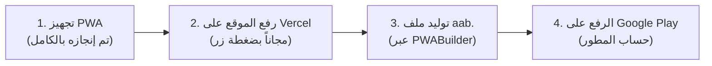

# دليل نشر تطبيق "كتاب قصتنا" على متجر جوجل بلاي (Google Play Store)

أهلاً بك! لقد قمنا بتجهيز مشروعك بالكامل ليكون متوافقاً مع أحدث معايير **Google PWA & TWA (Trusted Web Activity)**، وهو المعيار الرسمي المدعوم من شركة Google لتحويل تطبيقات الويب الحديثة إلى تطبيقات أندرويد حقيقية تُنشر على متجر Google Play.

---

## 🌟 لماذا تقنية TWA هي الخيار الأفضل لتطبيقك؟
1. **تحديث فوري تلقائي**: أي تعديل برمجته أو تصميم تضيفه للموقع مستقبلاً سيظهر فوراً لمستخدمي تطبيق الأندرويد دون الحاجة لإعادة رفع تحديث لمتجر Google Play في كل مرة!
2. **حجم خفيف جداً**: التطبيق سريع التحميل وحجمه خفيف جداً (~2 إلى 3 ميغابايت فقط).
3. **أداء وتجربة Native أصلية**: يعمل بملء الشاشة دون أي شريط للمتصفح، وبأيقوناتك وشاشات البداية المخصصة.

---

## 🗺️ خريطة الطريق: 4 خطوات بسيطة للنشر

---

## 🟢 الخطوة 1: تجهيز الكود كـ PWA (تم إنجازها بالفعل في مشروعك ✅)
لقد قمنا ببرمجة وتجهيز جميع الملفات المطلوبة داخل المشروع:
1. `src/app/manifest.ts`: تم ضبط اسم التطبيق (بالعربية والكردية والإنجليزية)، والألوان الدافئة (`#7C2D37` و `#FAF7F2`)، والشاشة المستقلة `standalone`.
2. `public/icons/`: تم توليد الأيقونات الرسمية لجميع الشاشات بدقة `192x192` و `512x512` و `Maskable` وأيقونة متجهة `icon.svg`.
3. `public/.well-known/assetlinks.json`: ملف ربط الدومين الأمني مع الأندرويد لإزالة شريط المتصفح وجعل التطبيق يبدو كتطبيق أصلي 100%.

---

## 🚀 الخطوة 2: رفع الموقع على الإنترنت (Deploy to Vercel)
بما أن التطبيق يعتمد على الإنترنت وقاعدة بيانات Supabase، يجب أن يكون له رابط حي آمن يبدأ بـ `https://`.
أفضل وأسهل طريقة مجانية ومصممة خصيصاً لـ Next.js هي **Vercel**:

1. اذهب إلى موقع [vercel.com](https://vercel.com) وسجل الدخول باستخدام حسابك على **GitHub**.
2. اضغط على زر **"Add New Project"** واختر مستودع مشروعك `our-story-book`.
3. في صفحة الإعدادات (Environment Variables)، أضف المتغيرين الخاصين بـ Supabase من ملف `.env.local`:
   - `NEXT_PUBLIC_SUPABASE_URL`
   - `NEXT_PUBLIC_SUPABASE_ANON_KEY`
4. اضغط **Deploy**.
5. خلال دقيقة واحدة، سيصبح لديك رابط مجاني عالمي مثل:
   `https://our-story-book.vercel.app` (أو أي دومين خاص بك).

---

## 📦 الخطوة 3: استخراج حزمة الأندرويد (`.aab`) مجاناً
Google Play يقبل الآن ملفات بصيغة **`.aab` (Android App Bundle)** وليس ملفات `.apk` القديمة.

1. افتح الموقع الرسمي المجاني من مايكروسوفت: [PWABuilder.com](https://www.pwabuilder.com).
2. ضع رابط موقعك (الذي حصلت عليه من Vercel في الخطوة 2) ثم اضغط **Start**.
3. سيفحص الموقع تطبيقك وسيمنحك تقييماً عالياً لأننا جهزنا له كل ملفات الـ PWA مسبقاً!
4. اضغط على خيار **"Package for Stores"** ثم اختر **Google Play (Android)**.
5. في نافذة الخيارات:
   - **Package ID**: ضعه مثل: `app.ourstorybook.twa`
   - **App Name**: `كتاب قصتنا — کتێبی چیرۆکمان`
   - **Short Name**: `Our Story Book`
6. اضغط على **"Generate"** وسيتم تحميل ملف مضغوط يحتوي على:
   - ملف `app-release.aab` (هذا هو الملف الذي سترفعه لجوجل بلاي).
   - ملف الشهادة `signing.keystore` (احفظ هذا الملف في مكان آمن جداً لأنك ستحتاجه لأي تحديثات مستقبلية).
   - بصمة الشهادة الرقمية **SHA-256 Fingerprint**.

> **ملاحظة هامة (إزالة شريط المتصفح):**
> عند توليد الحزمة سيعطيك الموقع كود SHA-256، كل ما عليك هو نسخه ووضعه داخل ملف `public/.well-known/assetlinks.json` في مشروعك ثم دفع التعديل لـ GitHub، وسيقوم نظام أندرويد تلقائياً بإخفاء شريط العنوان ويصبح التطبيق Fullscreen بالكامل!

---

## 🏪 الخطوة 4: فتح حساب Google Play Console ورفع التطبيق

1. **تسجيل حساب مطور Google Play**:
   - توجه إلى: [Google Play Console](https://play.google.com/console/signup).
   - يتطلب متجر جوجل رسوم تسجيل تُدفع **لمرة واحدة فقط** قيمتها **25 دولاراً** تمنحك صلاحية نشر عدد غير محدود من التطبيقات مدى الحياة.
2. **إنشاء التطبيق في لوحة التحكم**:
   - اضغط **Create App**.
   - اختر اسم التطبيق ولغته الأساسية (العربية).
   - حدد نوع التطبيق: **App** ومجاني: **Free**.
3. **إكمال بطاقة بيانات المتجر (Store Listing)**:
   - **العنوان**: كتاب قصتنا — كتێبی چیرۆکمان — Our Story Book
   - **الوصف القصير**: مساحة خاصة وآمنة لشخصين لتوثيق قصتهما المشتركة وذكرياتهما في كتاب رقمي دافئ.
   - **الوصف الكامل**: اكتب مميزات التطبيق (حفظ الذكريات المشتركة، هێڵی کاتی، طباعة الكتاب بجودة عالية، دعم العربية والكردية، حماية الخصوصية والتشفير).
   - **الأيقونة**: رفع الأيقونة الموجودة في `public/icons/icon-512.png`.
   - **لقطات الشاشة (Screenshots)**: التقط بضع صور جميلة لشاشات التطبيق من هاتفك (الخط الزمني، قارئ الكتاب، صفحة الذكريات).
4. **سياسة الخصوصية (Privacy Policy)**:
   - يتطلب جوجل رابط لسياسة الخصوصية. يمكنك إنشاء صفحة بسيطة تشرح أن بيانات المستخدمين والذكريات والصور مشفرة ومحفوظة بأمان ولا يتم مشاركتها مع أي جهة خارجية.
5. **رفع ملف `.aab` وإرساله للمراجعة**:
   - توجه إلى قسم **Production** ثم اضغط **Create new release**.
   - ارفع ملف `app-release.aab`.
   - اضغط **Review release** ثم **Start rollout to Production**.

🎉 **مبروك!** يدخل التطبيق مرحلة المراجعة لدى Google (تستغرق عادة من 24 ساعة إلى بضعة أيام)، وسيصبح متاحاً للتحميل لملايين المستخدمين على متجر Google Play!
